


  

<a href="https://durandev.vercel.app">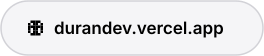</a>

<a href="https://www.instagram.com/durandev_">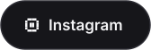</a>

   


   

<a href="https://durandev.vercel.app">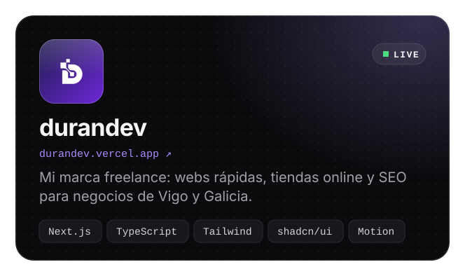</a>
<a href="https://stackhub-app.vercel.app"></a>
<a href="https://lahuelladepuri.vercel.app">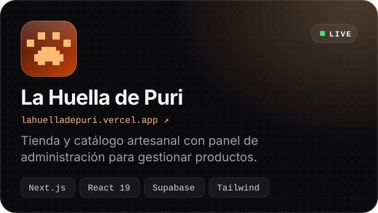</a>
<a href="https://interstellarfanpage.netlify.app">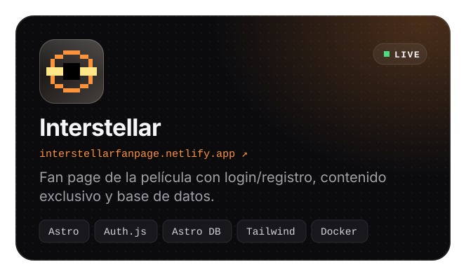</a>
<a href="https://github.com/davidvillard/drfbackendcheck">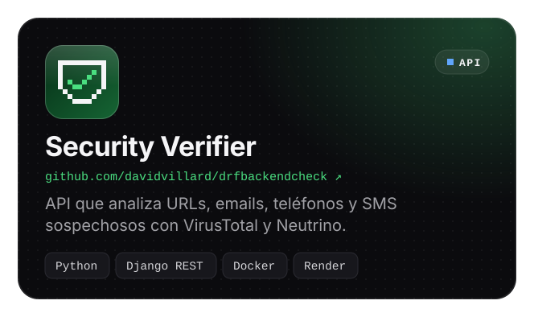</a>
<a href="https://github.com/sempereluismi/modular">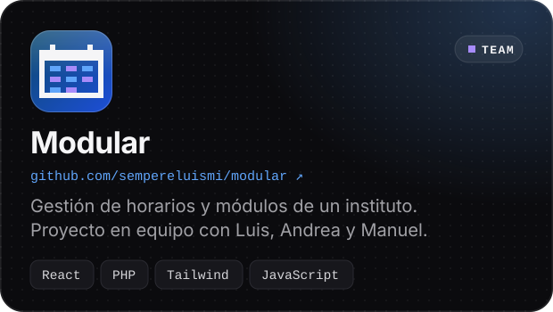</a>

Código: <a href="https://github.com/davidvillard/durandev-web">durandev-web</a> · <a href="https://github.com/davidvillard/StackHub">StackHub</a> · <a href="https://github.com/davidvillard/La-Huella-de-Puri">La-Huella-de-Puri</a> · <a href="https://github.com/davidvillard/Interstellar">Interstellar</a> · <a href="https://github.com/davidvillard/porfolio-davidvillard">porfolio</a>

   

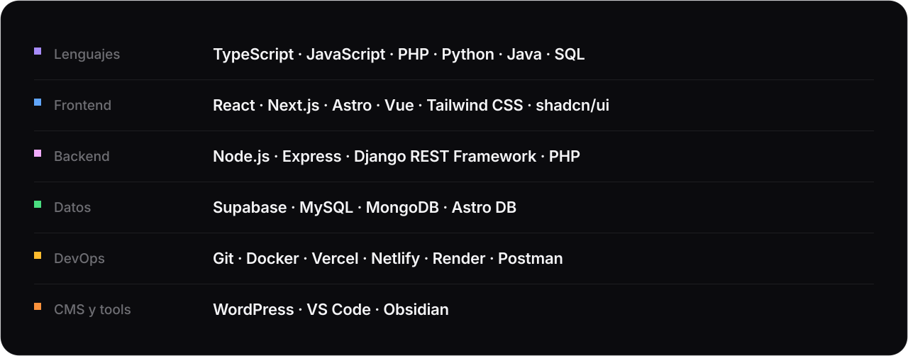

  

 

   

<picture>
  <source media="(prefers-color-scheme: dark)" srcset="https://raw.githubusercontent.com/davidvillard/davidvillard/output/snake-dark.svg"/>
  <source media="(prefers-color-scheme: light)" srcset="https://raw.githubusercontent.com/davidvillard/davidvillard/output/snake-light.svg"/>
  
</picture>

  

   

<a href="https://durandev.vercel.app"></a>

